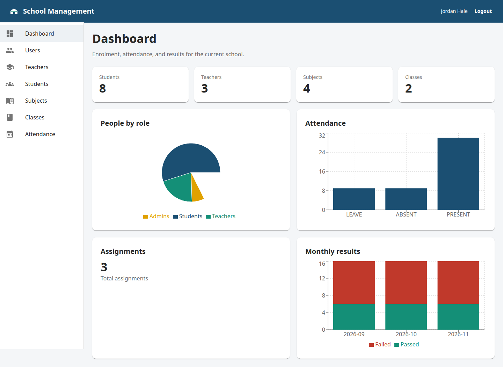
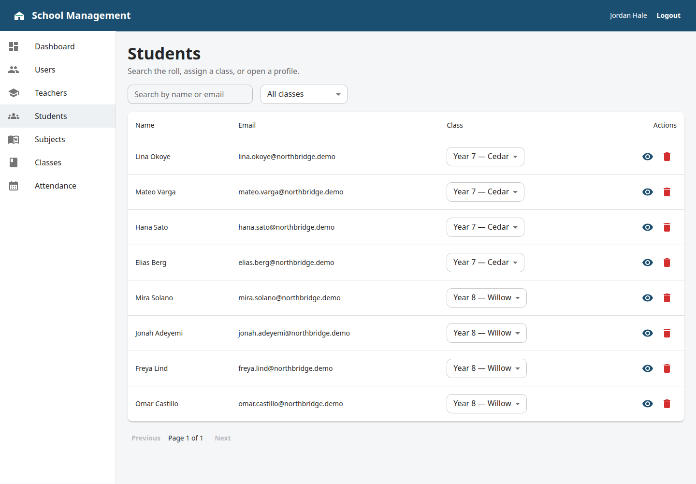
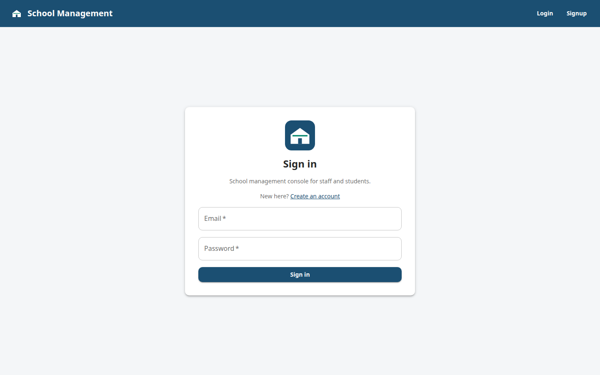

# School Management

Admin console for a school: people, classes, subjects, attendance, and results. This repository is the React client. The API lives in [SMS_Backend](https://github.com/hassan2314/SMS_Backend) (Express and Prisma).







## Features

- Sign in and sign up. Administrators land on the dashboard; other roles see a short home page.
- Dashboard with enrolment counts, people by role, attendance, assignment total, and monthly pass or fail.
- Users: filter by role, change a role, open a profile, add an account, and delete an account.
- Students: search, filter by class, assign a class, open attendance, and delete the account.
- Teachers and subject drop requests.
- Read-only lists for subjects, classes, and school-wide attendance.
- The browser session keeps the access token and profile. The password and refresh token from the login response are not stored.

## Stack

React 19, Vite 7, Material UI, React Router, Redux Toolkit, redux-persist, Axios, React Hook Form, and Recharts.

## Architecture

The Vite single-page app calls the Express API under `/api/v1` with Axios. The access token is sent as a bearer header. Express uses Prisma against PostgreSQL. `vercel.json` and `netlify.toml` send every frontend path back to `index.html`, so a refresh on `/admin/students` stays in the app.

## Setup

The API must already be running and must allow this app's origin. Locally that default is `http://localhost:5173`.

```bash
npm install
cp .env.example .env
```

For a backend on your machine, set:

```bash
VITE_API_BASE_URL=http://localhost:4000/api/v1
```

If `VITE_API_BASE_URL` is missing, the dev server uses `http://localhost:4000/api/v1`.

```bash
npm run dev
```

Open `http://localhost:5173`. Production build:

```bash
npm run build
npm run preview
```

## Environment variables

| Name | Where | Purpose |
| --- | --- | --- |
| `VITE_API_BASE_URL` | This app, at **build** time | Absolute API origin plus the `/api/v1` prefix. Example shape: `https://your-api-host.example.com/api/v1` |

Vite inlines `VITE_*` values when it builds. Set the variable in the host's dashboard before the build, and redeploy after you change it. `.env.example` has a placeholder only. Do not commit a real `.env`.

The API process (not this repo) must allow the deployed site:

| Name | Where | Purpose |
| --- | --- | --- |
| `CLIENT_URL` | SMS_Backend | Exact frontend origin, for credentialed CORS. Example: `https://your-app.vercel.app` |

The API also needs its own database URL and token secrets. Those stay on the API host.

The API stores the refresh token in a `SameSite=Strict` cookie. A frontend on another site will not receive that cookie, so silent refresh does not run across hosts. Sign-in and bearer requests still work for the life of the access token. Put the two apps on a parent and subdomain that count as the same site, or change the API cookie to `SameSite=None; Secure`, if sessions should refresh across hosts.

## Deploy

Nothing here requires a paid plan. Do not put the database in this project. Point `VITE_API_BASE_URL` at the API from SMS_Backend.

### Vercel

1. Import this Git repository. Framework preset: Vite.
2. Build command: `npm run build`. Output directory: `dist`.
3. Add `VITE_API_BASE_URL` for Production (and Preview, if you use it).
4. Deploy. `vercel.json` rewrites unknown paths to `/index.html`.

### Netlify

1. New site from this Git repository.
2. Build command: `npm run build`. Publish directory: `dist`. `netlify.toml` already sets both, plus a `200` rewrite from `/*` to `/index.html`.
3. Add `VITE_API_BASE_URL` in Site configuration, then deploy.

On either host, set the API's `CLIENT_URL` to the site origin (no path, no trailing slash) and redeploy the API if that value changes.
